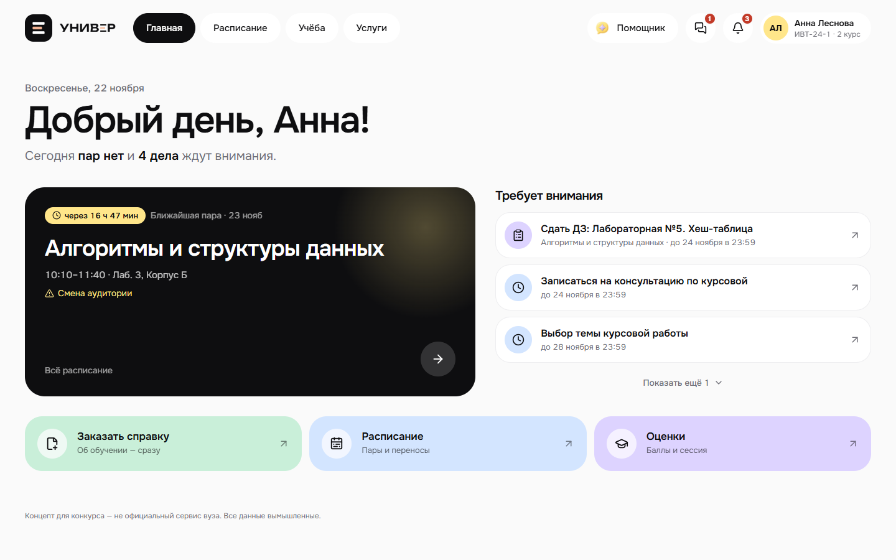
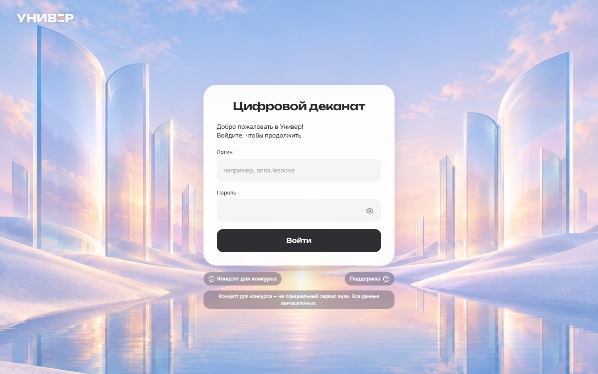
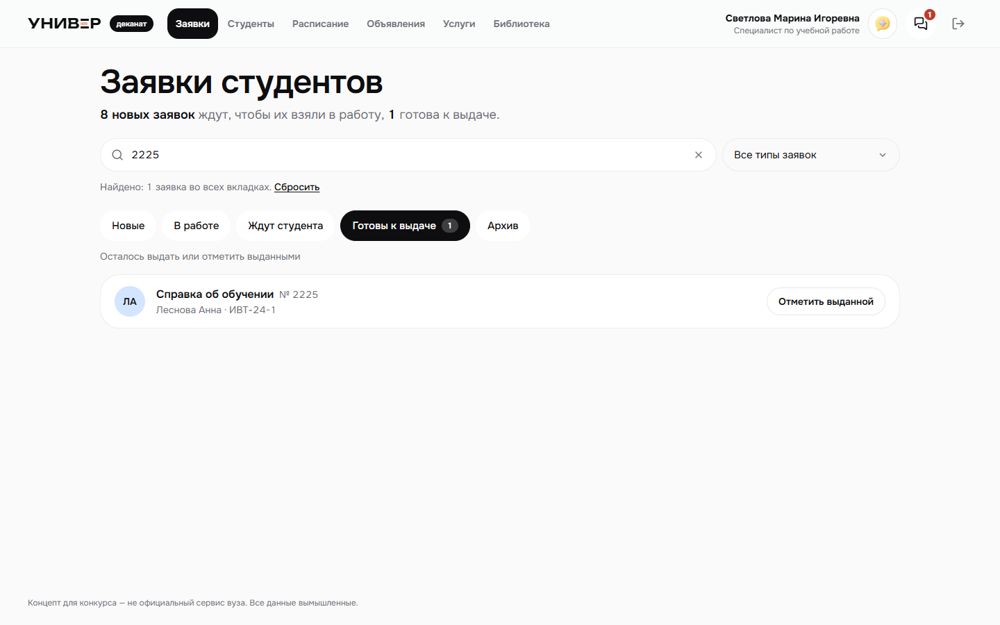
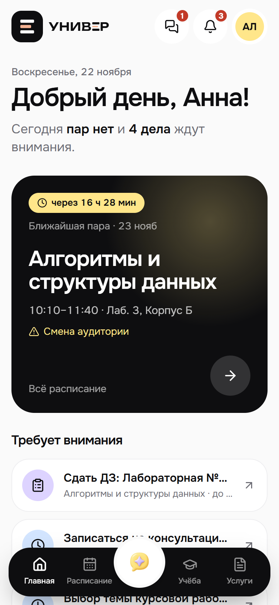
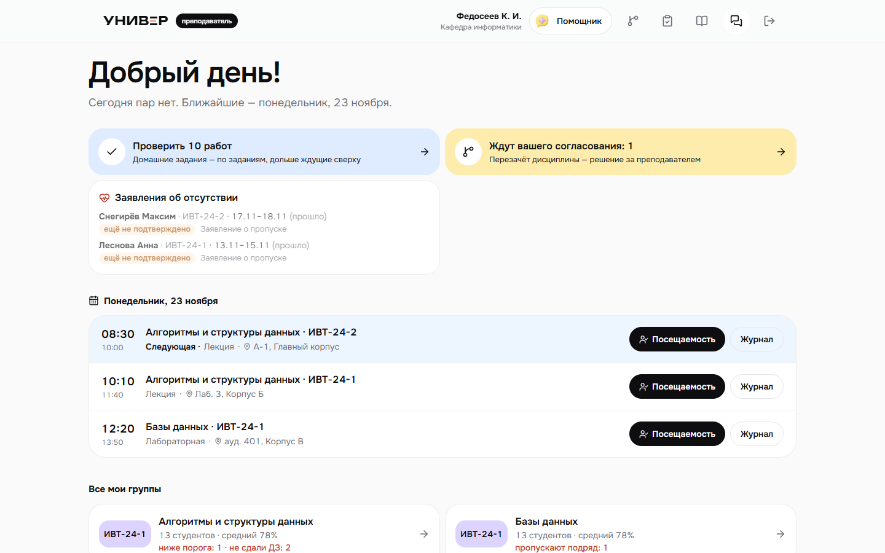

# «Цифровой деканат»: как мы создавали кабинет с нейросетями

> Копия документа Claude Docs от 22.11.2026 для агентов, у которых нет доступа к документу (ChatGPT/Codex, Kimi и другие). Скриншоты лежат рядом, в `screenshots/`. Правки предлагаются репликой в `R-20261122-otchet-dlya-zhyuri.md`. Координатор переносит их в документ и обновляет этот файл.

## Коротко о проекте

«Цифровой деканат» — личный кабинет вуза «Универ» для студента, преподавателя и сотрудника деканата. Он собран за 8 дней (15–22 ноября 2026) командой из людей и нейросетей и работает по адресу [service.setoffice.ru](https://service.setoffice.ru). Все студенты, оценки и документы в нём вымышленные.

Главные идеи:

- **«Мой день» вместо меню.** Главная показывает ближайшую пару и 3 дела, которые требуют внимания; перенос пары приходит сразу, в том числе push-уведомлением на телефон.
- **Прогноз оценки.** В «Учёбе» видно не только баллы, но и итог, к которому студент идёт, и сколько баллов не хватает до следующей оценки.
- **Справка за минуту.** Справка об обучении заказывается в один клик или фразой в чате и выдаётся сразу в PDF с QR-кодом проверки.
- **Помощник, который делает, а не только отвечает.** Нейросеть (GigaChat) распознаёт просьбу и готовит действие — заявку, отметку посещаемости, — а нажимает кнопку человек.

Кабинет ведёт студента от важного сигнала до результата: увидел → понял, что делать → сделал в один-два нажатия. Чтобы посмотреть это за 5 минут:

1. Войдите как студентка anna.lesnova: «Мой день» → «Учёба» с прогнозом → напишите помощнику «нужна справка для банка».
2. Войдите как деканат: во «Входящих» видна та же заявка; перенесите пару в «Расписании».
3. Войдите как преподаватель: отметьте посещаемость фразой «нет Лесновой» или поставьте оценку — и снова откройте кабинет студентки.

**Доступы для жюри**

| Роль | Логин | Пароль |
| --- | --- | --- |
| Студентка, без долгов | anna.lesnova | Anna-Univer-2026 |
| Студент, есть долг | petr.ozerov | Petr-Univer-2026 |
| Сотрудник деканата | dekanat | Dekanat-Univer-2026 |
| Преподаватель | teacher | Teacher-Univer-2026 |

## Какую проблему решает кабинет и почему такие разделы

Студенты узнают важное слишком поздно и через чужие руки: о переносе пары — от старосты, о долге — в сессию, за справкой идут в деканат лично. Вузовские сервисы при этом открывают редко: по материалу о данных ВШЭ, ими пользуются 9–12% студентов, а общение идёт в мессенджерах.

**Как искали боли.** 15 ноября два ИИ-агента Claude Code с веб-поиском параллельно разобрали отзывы на приложения ДВФУ, ННГУ и ПГУ в RuStore, статьи на Habr, vc и в Т—Ж, а также мировой опыт. Сильнее всего на выбор повлияли два факта: по данным Georgia State, чат-бот снизил летний отсев на 21,4% (рандомизированное исследование), а с системой ранних предупреждений выпуск вырос на 6 п.п. (по описанию самого университета). Для нашего кабинета такой эффект не измерялся. Вывод: помогает не число функций, а вовремя сказанное «что делать дальше».

| Боль студента | Раздел кабинета |
| --- | --- |
| О переносе пары узнают за 5 минут или от старосты | «Расписание» с подгруппой, всплывающее извещение и push на телефон |
| Расписание в PDF, видны все подгруппы | «Мой день»: только свои пары и дела |
| О долге и риске узнают в сессию | «Учёба»: прогноз итога, пороги, пересдачи, посещаемость |
| За справкой нужно идти в деканат | «Услуги»: справка с QR сразу, заявления со статусом и сроком |
| Непонятно, куда обратиться и что написать | Помощник: отвечает по библиотеке знаний и готовит заявку |
| ДЗ и материалы разбросаны по чатам | «Учёба»: материалы и сдача ДЗ с файлами и статусом |

Разделов у студента ровно четыре — Главная, Расписание, Учёба, Услуги. Это наше правило: новая функция встраивается внутрь, а не добавляет пункт меню. Кабинеты преподавателя и деканата появились потому, что без них студенту неоткуда получить оценку, перенос или справку.

**Что сказали однокурсники.** Открытый вопрос команде: если опрос будет, сюда — сколько человек ответили и три главных ответа. Без опроса честно пишем, что исследование кабинетное и частоты болей — гипотезы.

Источники: [отзывы на приложение ДВФУ](https://www.rustore.ru/catalog/app/ru.dvfu.univermobile/reviews), [ВШЭ о сервисах ЭИОС](https://skillbox.ru/media/education/elektronnye-informatsionnoobrazovatelnye-sredy-vuzov-obychno-ispolzuyutsya-ne-v-polnoy-mere/), [Georgia State, чат-бот Pounce](https://campustechnology.com/articles/2017/03/07/using-ai-chatbots-to-freeze-summer-melt-in-higher-ed.aspx), [Georgia State, раннее предупреждение](https://www.npr.org/sections/ed/2016/10/30/499200614/how-one-university-used-big-data-to-boost-graduation-rates).

## Как мы работали с нейросетями

Мы собрали из нейросетей команду с разными ролями, а сами стали её руководителями. Автор кода сам проверял свою работу тестами и в браузере, затем независимые нейросети других компаний проводили дополнительные аудиты, а решение, что исправлять, принимал человек.

Схема (в документе — рисунок):

```
                 Команда — решает
     (задачи, выбор вариантов, доступы, ключи)
        │ задачи            │                ▲ замечания
        ▼                   ▼                │
  Пишут код            Рисуют           Проверяют
  Claude Opus 5.5 —    OpenAI gpt-image Astra 6/6.1 Sol — 11 аудитов
   код и выкладка      фон входа,       Kimi 3.1 Pro — ревью и аудиты
  Claude Fable 5.1 —    иконка          ChatGPT — дизайн и тексты
   архитектура              │                ▲
  Claude Sonnet 5.5 —       │ картинки       │ проверяют
   субагенты                ▼                │
        │ код ──────► Сервис service.setoffice.ru ─┘
                      внутри — GigaChat-2: помощник и распознавание
```

Правила работы записаны в общем файле для всех агентов (AGENTS.md). Вот четыре главных:

1. Всё, что заметно снаружи, — отправка кода, действия на сервере, платные генерации, — только по команде человека.
2. Агент проверяет свою работу сам: тесты, сборка, проход в браузере на ширине телефона 360 px.
3. Каждый этап записывается в журнал: задача, инструмент, результат, ошибки ИИ.
4. Секреты агенты не читают и не правят — их вписывает команда.

## Инструменты и сервисы

Код писали модели Claude, проверяли другие нейросети (Codex и Kimi), картинки рисовала модель OpenAI, а внутри самого сервиса работает GigaChat.

| Инструмент | Для чего использовали |
| --- | --- |
| Claude Code (приложение Claude для компьютера), модель Claude Opus 5.5 | Основной разработчик: план, код всех экранов, база данных, тесты, исправления по аудитам, выкладка на сервер, этот отчёт |
| Claude Fable 5.1 (в том же чате Claude Code) | Архитектура: стек, модель данных, схема входа и разграничения доступа, план из 19 задач |
| Claude Sonnet 5.5 (субагенты) | Параллельная сборка по чёткому заданию: кабинет деканата, PDF-справки с QR, кабинет преподавателя |
| Субагенты Claude с веб-поиском | Исследование: отзывы студентов о кабинетах вузов и мировой опыт |
| Claude in Chrome и встроенный браузер Claude | Проверка «глазами пользователя»: сценарии всех ролей, экраны 360–2560 px, скриншоты |
| Codex (OpenAI), модели ChatGPT Astra 6 и Astra 6.1 Sol, с Computer Use | 11 независимых аудитов, часть — в браузере: агент сам открывал сервис, проходил экраны и смотрел вёрстку. Темы: безопасность, пользовательские сценарии, дизайн, адаптивность, контроль исправлений, соответствие условиям конкурса |
| Kimi Code CLI | Модель Kimi 3.1 Pro. Ревью и аудиты без правок кода, в том числе с проверкой в браузере: замечания к сообщениям и управлению аккаунтами, реплики в карточках идей |
| OpenAI Image API, модель gpt-image-2.5-flare | Фон страницы входа (1 генерация) и иконка помощника (3 варианта, выбран один) |
| ChatGPT | Модели Astra 6 и 6.1 Sol: аудиты дизайна и текстов, замечания по разделу «Учёба», проверка этого отчёта |
| GigaChat (Сбер), модель GigaChat-2 | Нейросеть внутри сервиса: ответы помощника, распознавание просьб и отметок посещаемости. Работает из России |
| GitHub, GitHub Desktop | Хранение кода и история изменений |
| VPS Jino, Docker, nginx | Сервер, на котором работает сервис |
| Claude Docs | Этот отчёт |

Открытый вопрос команде: чем ещё пользовались вне чатов с Claude — редактор кода, Figma, другие нейросети для текстов или картинок?

## Этапы работы: промпты, ошибки, исправления

За 8 дней прошли 10 этапов и сделали более 50 коммитов. Полный журнал — в репозитории, файл docs/process-log.md: там каждая задача, инструмент и более 80 пронумерованных ошибок ИИ с исправлениями (на 22 ноября).

### 1. ТЗ, исследование и архитектура · 15 ноября

Claude Opus разобрал ТЗ и предложил распределить роли между моделями. Два агента с веб-поиском собрали боли студентов, затем в том же чате модель переключили на Claude Fable для архитектуры.

> Промпт: «Приступай к задаче для модели Fable с проработкой архитектуры и прочих системных элементов» + задание в файле docs/02-architecture-brief.md.

Ошибка ИИ: архитектор додумал название вуза и выбор нейросети, не спросив команду. Оба решения команда поменяла.

### 2. Рабочий прототип за один день · 15 ноября

Opus собирал кабинет студента, а параллельно субагент Sonnet получил кабинет деканата и PDF-справки. Главное в задании — границы и обязательная самопроверка.

> Промпт субагенту (сокращённо): «Ты — разработчик в команде… Твоя зона: repos/staff.ts, /staff/*, certificates.ts, /verify… НЕ трогай файлы студента… Проверка обязательна: сгенерируй PDF и убедись, что кириллица встроена… В конце — отчёт: файлы, что проверено, что не получилось, решения, сомнения».

Ошибка ИИ: субагент сгенерировал справку «вслепую». При просмотре нашли «г. г.», «он(а)» и неверный падеж.

### 3. Дизайн по образцам и картинки нейросети · 15 ноября

Команда присылала образцы, Opus адаптировал их, а не копировал: свой логотип «УНИВЕР», свои цвета по смыслу разделов, шрифт с кириллицей. Фон входа и иконку помощника нарисовала модель OpenAI.

> Промпт для фона: «Dreamy pastel surreal landscape for a university web app login background… Tall translucent frosted-glass arches… shaped like the pages of an open book… empty calm area in the center for a login card. No text, no logos, no people».

Неудачный вариант: первый дизайн команда назвала «сложным и запутанным»: 7 пунктов меню и «Ещё». В третьей версии осталось 4 раздела. На широком мониторе кабинет был зажат в узкую колонку: ИИ проверял только телефон и один ноутбук.

Версия 1, первый прототип (коммит d14ca7c от 15 ноября, воспроизведён 22 ноября на вымышленных данных): на мониторе 1920 px кабинет зажат в узкую колонку, в меню 7 пунктов.


Версия 2 (коммит 259c205 от 15 ноября, воспроизведён 22 ноября): свой логотип и пастельные цвета, но на главной всё сразу: помощник «Уни», объявление, настроение недели. Команда: «глаза разбегаются».


Итоговая версия: 4 раздела в шапке, одна фраза о дне, ближайшая пара и 3 дела.



Фон страницы входа и иконка помощника нарисованы моделью OpenAI gpt-image-2.5-flare. Страница входа снята с опубликованного сервиса: только логин и пароль, без быстрого входа.




### 4. Проверка «глазами пользователя» в браузере · 15–16 ноября

Команда попросила агента самого пройти кабинет в Chrome как студент, преподаватель и деканат. Агент обнаружил, что оценку поставить некуда: роли преподавателя не было. Её добавили в тот же день, а входящие деканата перестроили по шагам работы.

Ошибка ИИ, которую не поймали ни линтер, ни сборка: страница помощника падала в новом Chrome. Нашли её только ручной проверкой.

### 5. Помощник, который делает · 16 ноября

Обсудили с ИИ два подхода: нейросеть только читает данные или сама вызывает функции. Команда выбрала третий путь: нейросеть распознаёт намерение и показывает карточку, а нажимает человек. Преподаватель пишет «нет Зорина и Лесновой» — помощник готовит отметку посещаемости. Студент пишет «нужна справка для банка» — помощник готовит заявку.

Удачная находка при проверке: в группе два Зорина, и помощник не угадывает, а переспрашивает: «Зорин Даниил или Зорин Никита?»

Сценарий целиком, снят 22 ноября: студентка пишет «Нужна справка об обучении для банка» → помощник готовит карточку → после нажатия «Заказать» создаётся заявка № 2225.


Та же заявка № 2225 сразу видна деканату. Справка об обучении выдаётся сразу, поэтому она во вкладке «Готовы к выдаче».



### 6. Функции для всех ролей · 16–21 ноября

По плану команды добавили push-уведомления, материалы и ДЗ с файлами, успеваемость для деканата, сообщения, библиотеку знаний и «единое окно» услуг. Неудачный вариант: «Учёба» с цветной плашкой у каждой строки — когда цветное всё, не выделяется даже долг. По скриншоту команды оставили цвет только у долга.

«Учёба» до разгрузки (коммит 66f2f62 от 16 ноября, воспроизведён 22 ноября; сравнивается устройство экрана, демо-значения различаются): плашки у каждой строки, две колонки читаются «змейкой».


«Учёба» сейчас: прогноз итога крупно, цвет только у долга и риска, пересдача сверху.


### 7. Несколько агентов в одном проекте · 17–18 ноября

Чтобы разные нейросети не мешали друг другу, завели общие правила (файл AGENTS.md) и папку карточек идей: агент предлагает, другие отвечают, решает команда. Пример: пока Claude писал сообщения, Kimi (модель Kimi 3.1 Pro) в режиме чтения нашёл 5 рисков доступа. Все пять учли до релиза.

### 8. Одна нейросеть пишет, другая проверяет · 21–22 ноября

Codex (модели ChatGPT Astra 6 и 6.1 Sol) провёл 11 аудитов 21–22 ноября, часть — проходя сервис в браузере: безопасность, сценарии, дизайн, адаптивность и контроль уже сделанных исправлений. Claude разбирал каждое замечание по коду и не соглашался вслепую: часть правок откатили, потому что они ломали просмотр PDF.

> Промпт команды: «Изучи новый аудит чата GPT и внеси изменения, исправив ошибки».

Самая важная находка: преподаватель одной подгруппы мог поставить оценку студенту другой. Исправили во всех местах и закрепили тестами.

Как это выглядело на практике:

1. **Замечание аудитора** (аудит безопасности 22 ноября, пункт S03): «Граница подгруппы не применяется к журналу и текущим оценкам». Аудитор не ограничился чтением кода: в тестовом запуске он действительно поставил оценку студенту чужой подгруппы.
2. **Задача автору:** «Да, разобрать» — команда передала отчёт в Claude.
3. **Исправление:** одна проверка «ведёт ли преподаватель подгруппу студента» добавлена в журнал, оценки, массовое выставление, проверку ДЗ, аналитику и выдачу файлов.
4. **Повторная проверка:** новый автотест повторяет сценарий аудитора и теперь получает отказ.

### 9. GigaChat: человек поправил ИИ · 22 ноября

Claude предложил сложную схему подключения. Команда прислала инструкцию Сбера со словами «Мне кажется, ты переусложняешь», и схему упростили. Ещё одна ошибка ИИ: модель «GigaChat» по новому адресу API не отвечала; нужное имя — «GigaChat-2».

И важный урок: агент однажды сам поправил файл с ключами. Команда остановила это, и появилось правило для всех агентов: файл с секретами не открывать, проверять только через работающее приложение.

### 10. Публикация · 22 ноября

Claude осмотрел сервер, не трогая соседние сервисы, и выложил кабинет. Команда сама вписала ключи через консоль Jino. На сервере всплыли две ошибки сборки, которых не было на Windows; их исправили и проверили сборку во временной копии, прежде чем выкладывать.

Готовый кабинет: студент на телефоне, преподаватель и деканат на компьютере.






## Вход, хранение данных и защита

Каждый видит только своё: это проверяет сервер при каждом запросе, а не кнопки на экране. Правила закреплены автотестами (на контрольном прогоне прошло 154 теста, в том числе проверки разграничения доступа) и проверены тремя аудитами безопасности другой нейросети (Codex).

**Вход**

- Логин и пароль, как в настоящем кабинете. Быстрый вход без пароля был только для разработки и на опубликованном сервисе выключен.
- Пароли хранятся не в виде текста, а в виде «отпечатка» (argon2id): даже с доступом к базе пароль не прочитать.
- После входа браузер получает случайный ключ сессии, недоступный скриптам страницы. В базе лежит только отпечаток этого ключа.
- Число попыток входа ограничено: это снижает риск подбора пароля перебором. Временный пароль от деканата нужно сменить при первом входе, и все старые сессии при этом закрываются.

**Кто что видит**

| Роль | Видит | Не видит |
| --- | --- | --- |
| Студент | Свои оценки, заявки, справки, сдачи ДЗ; расписание и материалы своей группы | Данные других студентов: чужая ссылка отдаёт «не найдено» |
| Преподаватель | Свои группы и подгруппы: журнал, ДЗ, посещаемость | Чужие группы; поставить там оценку нельзя |
| Деканат | Заявки, расписание, успеваемость своего факультета; сотрудник уровня вуза — всех факультетов | Файлы с решениями студентов; сотрудник факультета — другие факультеты |

**Хранение**

- Данные лежат в базе PostgreSQL на нашем сервере в России (Jino). Из интернета база недоступна: снаружи открыт только сайт по HTTPS.
- Файлы ДЗ и материалов хранятся под случайными именами и скачиваются только после проверки прав. Принимаются только Word, PDF, Excel и PowerPoint, до 10 МБ на файл.
- Ключи (GigaChat, пароль базы) лежат только в файле настроек на сервере, не в коде. После случая, когда агент изменил файл настроек, команда запретила ассистентам читать и менять его; дальше настройки вписывала команда вручную. Файлы с ключами в историю Git не попадали (проверено 22 ноября).
- Каждую ночь в 3:00 по расписанию снимается резервная копия базы и файлов; пробный запуск 22 ноября прошёл успешно.

**Нейросеть и данные**

- Помощник получает только сведения, доступные пользователю по его роли: студенту — его собственные, преподавателю и деканату — их студентов. Текст пользователя помечен как данные, чтобы его нельзя было выдать за команду.
- Нейросеть ничего не делает сама: она готовит карточку, а заявку или отметку сохраняет человек. Оценки через нейросеть не ставятся совсем: цена ошибки распознавания «18» → «13» слишком высока.
- Без нейросети сервис продолжает работать: помощник отвечает по правилам и ищет по библиотеке знаний.

**Что ещё нужно для настоящих данных.** Сейчас данные вымышленные. Перед запуском в вузе нужны: отдельная учётная запись базы с минимальными правами, зашифрованные копии вне сервера, второй фактор входа для сотрудников и согласованная с вузом политика передачи данных нейросети.

## Что сделали вручную

Решения и доступы оставались за людьми; нейросети предлагали и исполняли. Действия агента в браузере сюда не входят — здесь только то, что делала команда.

**Продуктовые решения**

- Выбрали роли и название вуза: архитектор предложил «Ладогу», команда выбрала «Универ».
- Решили не отдавать нейросети оценки и придумали принцип «ИИ распознаёт → человек нажимает».
- Задали правило «четыре раздела у студента» и решили, какие функции делать дальше: идеи агентов принимались только после решения команды.
- Подобрали образцы дизайна (экран входа ITMO ID, помощник my.itmo, сайт rondesignlab.com) и сказали, что именно нравится.

**Проверка и обратная связь**

- Смотрели кабинет на своих экранах и присылали скриншоты с замечаниями: «глаза разбегаются», «перегруз», «на широком мониторе половина экрана пустая».
- Работали координаторами: передавали отчёты аудитов Codex и Kimi в Claude и решали, какие замечания исправлять первыми.
- Выбрали иконку помощника из трёх сгенерированных вариантов и разрешали каждую платную генерацию.

**Доступы и сервер**

- Опубликовали репозиторий на GitHub через GitHub Desktop; каждую отправку кода агент делал только по команде.
- Получили ключ GigaChat в личном кабинете Сбера и сами вписали его в настройки на компьютере и на сервере.
- Подготовили поддомен service.setoffice.ru на VPS Jino, добавили ключ доступа агента через веб-консоль Jino и ключ для чтения репозитория на GitHub.
- Открытый вопрос команде: проверить вход по паролям на опубликованном сервисе и записать сюда результат (агент 22 ноября проверил пароли только по базе на сервере).

Открытый вопрос команде: что ещё делали сами — тексты, опрос, проверка на телефоне, подготовка сервера?

## Итог

За 8 дней нейросети под руководством команды собрали работающий кабинет для трёх ролей. В нём 59 маршрутов (страницы и API), 154 автотеста на контрольном прогоне, мобильная версия и помощник на российской нейросети. Главное, что мы вынесли из работы с ИИ:

- **Нейросети ошибаются уверенно.** Мы записали в журнал более 80 ошибок ИИ; часть из них не ловит ни сборка, ни тесты, только человек или агент в браузере.
- **Проверять должна другая модель.** Самая серьёзная дыра в доступе нашлась не у автора кода, а у независимого аудитора.
- **Решения — за людьми.** Лучшие повороты проекта — четыре раздела, «ИИ распознаёт, человек нажимает», простое подключение GigaChat — предложила команда, а не нейросеть.

Чего мы не утверждаем: справка с QR — не юридически значимый документ, эффект на успеваемость не измерен, нагрузка целого вуза не проверялась. Следующий шаг — пилот с одной группой и меры защиты для настоящих данных из раздела выше.
