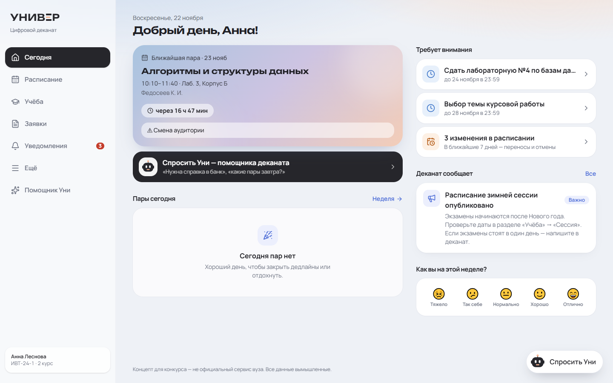
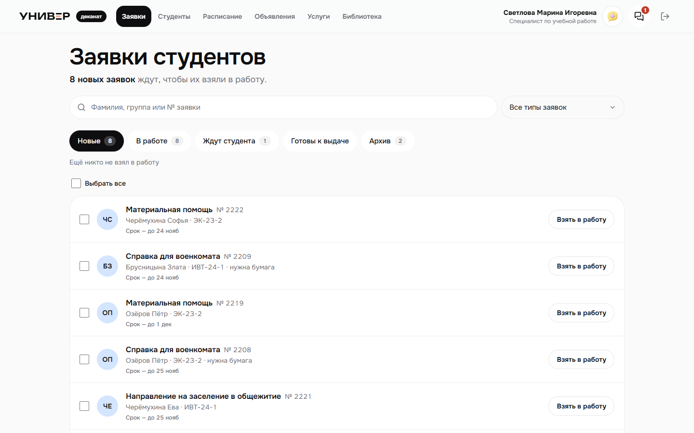

# «Цифровой деканат»: как мы создавали кабинет с нейросетями

> Копия документа Claude Docs от 22.11.2026 для агентов, у которых нет доступа к документу (ChatGPT/Codex, Kimi и другие). Скриншоты лежат рядом, в `screenshots/`. Правки предлагаются репликой в `R-20261122-otchet-dlya-zhyuri.md`. Координатор переносит их в документ и обновляет этот файл.

## Коротко о проекте

«Цифровой деканат» — личный кабинет вуза «Универ» для студента, преподавателя и сотрудника деканата. Он собран за 8 дней (15–22 ноября 2026) командой из людей и нейросетей и работает по адресу [service.setoffice.ru](https://service.setoffice.ru). Все студенты, оценки и документы в нём вымышленные.

Главные идеи:

- **«Мой день» вместо меню.** Главная показывает ближайшую пару и 3 дела, которые требуют внимания; перенос пары приходит сразу, в том числе push-уведомлением на телефон.
- **Прогноз оценки.** В «Учёбе» видно не только баллы, но и итог, к которому студент идёт, и сколько баллов не хватает до следующей оценки.
- **Справка за минуту.** Справка об обучении заказывается в один клик или фразой в чате и выдаётся сразу в PDF с QR-кодом проверки.
- **Помощник, который делает, а не только отвечает.** Нейросеть (GigaChat) распознаёт просьбу и готовит действие — заявку, отметку посещаемости, — а нажимает кнопку человек.

Кабинет ведёт студента от важного сигнала до результата: увидел → понял, что делать → сделал в один-два нажатия. Чтобы посмотреть это за 5 минут:

1. Войдите как студентка anna.lesnova: «Мой день» → «Учёба» с прогнозом → напишите помощнику «нужна справка для банка».
2. Войдите как деканат: во «Входящих» видна та же заявка; перенесите пару в «Расписании».
3. Войдите как преподаватель: отметьте посещаемость фразой «нет Лесновой» или поставьте оценку — и снова откройте кабинет студентки.

**Доступы для жюри**

| Роль | Логин | Пароль |
| --- | --- | --- |
| Студентка, без долгов | anna.lesnova | Anna-Univer-2026 |
| Студент, есть долг | petr.ozerov | Petr-Univer-2026 |
| Сотрудник деканата | dekanat | Dekanat-Univer-2026 |
| Преподаватель | teacher | Teacher-Univer-2026 |

## Как мы изучали рынок и что из этого взяли

Мы начали не с экранов, а с вопроса нейросети о том, что студенты уже ругают и что работает у других:

> «…просмотреть в интернете отзывы и прочие площадки, где общаются студенты. При этом давай смотреть какой-нибудь передовой мировой опыт. На что сейчас есть запрос со стороны студентов?»

Два агента Claude с веб-поиском работали параллельно. Первый разбирал отзывы о приложениях ДВФУ, ННГУ и ПГУ, статьи на Habr и материалы ВШЭ. Второй изучал мировой опыт: Georgia State, Open University, Jisc, EDUCAUSE. Оба честно записали ограничения: Reddit, App Store и Google Play им были недоступны, цифры вендоров помечены отдельно.

**Находка, которая поменяла фокус.** Студбилет и зачётка уходят в Госуслуги и MAX, а расписание в MAX уже есть для сотни вузов. Значит, соревноваться расписанием бессмысленно. Выделяться нужно тем, чего в общих сервисах нет: заявками и справками со статусом и тем, что кабинет сам подсказывает следующий шаг.

| Что увидели | Что взяли | Что не взяли и почему |
| --- | --- | --- |
| О переносе пары узнают за 5 минут или от старосты | Извещение поверх любой страницы и push на телефон | Офлайн-режим и экспорт в календарь отложили: сначала главное |
| В расписании видны все подгруппы | «Мой день»: только свои пары и дела | — |
| Электронную справку не принимает военкомат | Справка с QR сразу и галочка «нужна бумага с печатью» | Юридически значимую подпись не обещаем |
| Georgia State: чат-бот, который подталкивает к следующему шагу | Помощник пишет первым и готовит действие | Действия без подтверждения человека |
| Раннее предупреждение о риске отсева | Прогноз итога в «Учёбе», ведомость и личное дело для деканата | Ярлык «зона риска» вместо инструмента |
| Вузы Китая и США: eHall, пропуск в Wallet, выписка оценок по QR | Идею «жизненных ситуаций» в услугах | Пропуск и выписку сняли как невостребованные |
| Образцы дизайна: ITMO ID, помощник my.itmo, rondesignlab.com | Выездная панель помощника, подсказки-«чипсы», пастель, капсулы навигации | Копирование: свой логотип, шрифт с кириллицей, цвета по смыслу разделов |
| Отдельные кабинеты для бухгалтерии, военно-учётного стола, ИТ | Услуги деканата в одном окне | Лишние роли: профильные услуги убрали |

Когда нейросеть принесла «модные» идеи зарубежных вузов, команда вернула её к базовому:

> «…цифровой пропуск и выгрузка оценок по QR — это не самые востребованные задания… Какие из обычных функций мы могли просто упустить?»

Нейросеть сняла свои пункты и нашла реальный пробел: одобренная уважительная причина не меняла посещаемость.

**Что сказали однокурсники.** Открытый вопрос команде: если опрос будет, сюда — сколько человек ответили и три главных ответа. Без опроса пишем, что исследование кабинетное.

Источники: [отзывы на приложение ДВФУ](https://www.rustore.ru/catalog/app/ru.dvfu.univermobile/reviews), [ВШЭ о сервисах ЭИОС](https://skillbox.ru/media/education/elektronnye-informatsionnoobrazovatelnye-sredy-vuzov-obychno-ispolzuyutsya-ne-v-polnoy-mere/), [Georgia State, чат-бот Pounce](https://campustechnology.com/articles/2017/03/07/using-ai-chatbots-to-freeze-summer-melt-in-higher-ed.aspx), [Georgia State, раннее предупреждение](https://www.npr.org/sections/ed/2016/10/30/499200614/how-one-university-used-big-data-to-boost-graduation-rates).

## Как мы работали с нейросетями

Мы собрали из нейросетей команду с разными ролями, а сами стали её руководителями. Автор кода сам проверял свою работу тестами и в браузере, затем независимые нейросети других компаний проводили дополнительные аудиты, а решение, что исправлять, принимал человек.

Схема (в документе — рисунок):

```
                 Команда — решает
     (задачи, выбор вариантов, доступы, ключи)
        │ задачи            │                ▲ замечания
        ▼                   ▼                │
  Пишут код            Рисуют           Проверяют
  Claude Opus 5.5 —    OpenAI gpt-image Astra 6/6.1 Sol — 11 аудитов
   код и выкладка      фон входа,       Kimi 3.1 Pro — ревью и аудиты
  Claude Fable 5.1 —    иконка          ChatGPT — дизайн и тексты
   архитектура              │                ▲
  Claude Sonnet 5.5 —       │ картинки       │ проверяют
   субагенты                ▼                │
        │ код ──────► Сервис service.setoffice.ru ─┘
                      внутри — GigaChat-2: помощник и распознавание
```

Правила работы записаны в общем файле для всех агентов (AGENTS.md). Вот четыре главных:

1. Всё, что заметно снаружи, — отправка кода, действия на сервере, платные генерации, — только по команде человека.
2. Агент проверяет свою работу сам: тесты, сборка, проход в браузере на ширине телефона 360 px.
3. Каждый этап записывается в журнал: задача, инструмент, результат, ошибки ИИ.
4. Секреты агенты не читают и не правят — их вписывает команда.

## Инструменты и сервисы

Код писали модели Claude, проверяли другие нейросети (Codex и Kimi), картинки рисовала модель OpenAI, а внутри самого сервиса работает GigaChat.

| Инструмент | Для чего использовали |
| --- | --- |
| Claude Code (приложение Claude для компьютера), модель Claude Opus 5.5 | Основной разработчик: план, код всех экранов, база данных, тесты, исправления по аудитам, выкладка на сервер, этот отчёт |
| Claude Fable 5.1 (в том же чате Claude Code) | Архитектура: стек, модель данных, схема входа и разграничения доступа, план из 19 задач |
| Claude Sonnet 5.5 (субагенты) | Параллельная сборка по чёткому заданию: кабинет деканата, PDF-справки с QR, кабинет преподавателя |
| Субагенты Claude с веб-поиском | Исследование: отзывы студентов о кабинетах вузов и мировой опыт |
| Claude in Chrome и встроенный браузер Claude | Проверка «глазами пользователя»: сценарии всех ролей, экраны 360–2560 px, скриншоты |
| Codex (OpenAI), модели ChatGPT Astra 6 и Astra 6.1 Sol, с Computer Use | 11 независимых аудитов, часть — в браузере: агент сам открывал сервис, проходил экраны и смотрел вёрстку. Темы: безопасность, пользовательские сценарии, дизайн, адаптивность, контроль исправлений, соответствие условиям конкурса |
| Kimi Code CLI | Модель Kimi 3.1 Pro. Ревью и аудиты без правок кода, в том числе с проверкой в браузере: замечания к сообщениям и управлению аккаунтами, реплики в карточках идей |
| OpenAI Image API, модель gpt-image-2.5-flare | Фон страницы входа (1 генерация) и иконка помощника (3 варианта, выбран один) |
| ChatGPT | Модели Astra 6 и 6.1 Sol: аудиты дизайна и текстов, замечания по разделу «Учёба», проверка этого отчёта |
| GigaChat (Сбер), модель GigaChat-2 | Нейросеть внутри сервиса: ответы помощника, распознавание просьб и отметок посещаемости. Работает из России |
| GitHub, GitHub Desktop | Хранение кода и история изменений |
| VPS Jino, Docker, nginx | Сервер, на котором работает сервис |
| Claude Docs | Этот отчёт |

Открытый вопрос команде: чем ещё пользовались вне чатов с Claude — редактор кода, Figma, другие нейросети для текстов или картинок?

## Ключевые решения и как мы к ним пришли

Нейросеть предлагала быстро и много, поэтому главной работой команды стало выбирать и отсекать. Ниже — восемь развилок. В каждой есть цитата из нашего диалога с ИИ: мы много диктовали голосом, поэтому цитаты чуть сокращены. Полный журнал с более чем 80 пронумерованными ошибками ИИ — в репозитории, docs/process-log.md.

### 1. Для кого кабинет: две роли, три или пять

Нейросеть предложила две роли — студент и деканат: «кабинет преподавателя удваивает объём работы». Но когда мы прошли прототип руками, оказалось, что студенту неоткуда получить оценку:

> «У учителя у тебя какая-то мешанина… ни куда оценку поставить, ни где заявки».

Так появился преподаватель. Позже нейросеть пошла в другую крайность и предложила отдельные кабинеты для бухгалтерии, студгородка и ИТ. Команда остановила:

> «Давай не будем плодить слишком много сущностей… Перенеси те услуги, которые потенциально могут быть у деканата, в деканат, а те, которые требуют исключительно профильных решений, удали».

Итог: три роли. Матпомощь, реквизиты и направление в общежитие ведёт деканат, а «Ремонт в комнате» и «Доступ и пароли» убрали совсем.

### 2. Четыре раздела и «не всё сразу»

Первая сборка была полной, но тяжёлой: 7 пунктов меню, «Ещё», плавающая кнопка. Мы сформулировали задачу через ощущение пользователя, а не через список правок:

> «Сайт должен выглядеть как, условно, приложение, в которое хочется заходить… а не как скучный кабинет, из которого хочется поскорее уйти».
>
> «…очень сильно глаза разбегаются… Как бы весь функционал как бы остался, но не весь сразу лезет на просмотр».

Из этого родилось правило для всех агентов: у студента ровно четыре раздела, а новая функция встраивается внутрь. ДЗ, материалы и посещаемость живут в «Учёбе», сообщения — значком в шапке. Нейросеть потом сама применила его к деканату: «пятый пункт на телефоне уже не помещается».

Первый прототип (коммит d14ca7c, воспроизведён на вымышленных данных): 7 пунктов меню, на мониторе 1920 px кабинет зажат в узкую колонку.


Вторая версия (коммит 259c205): свой стиль, но на главной всё сразу — именно на неё команда сказала «глаза разбегаются».



Итог: 4 раздела в шапке, одна фраза о дне, ближайшая пара и 3 дела. Ни одна функция не удалена, второстепенное спрятано за «Показать ещё».


То же случилось с «Учёбой». На скриншот команды «это перегруз» нейросеть сделала точный разбор: «когда цветное всё, не выделяется ничего, даже долг», а две колонки «читаются змейкой». Оставили одну колонку и цвет только у долга и риска. На снимках сравнивается устройство экрана, демо-значения различаются.


### 3. Образцы без копирования

Мы давали нейросети скриншоты-ориентиры и просили вдохновляться, а не переносить:

> «…для Универа придумаем какой-нибудь симпатичный логотип. Можешь вдохновиться, условно, надписью «ИТМО»…»

Из образцов взяли приёмы, а не вид. Логотип «УНИВЕР» перекликается с ИТМО, но не копирует его: буква «Е» собрана из трёх плашек, как стопка документов. Шрифт образца не умеет кириллицу — взяли Onest. Цвета привязали к смыслу: мятный — справки, голубой — расписание. Фон входа и иконку помощника нарисовала модель OpenAI gpt-image-2.5-flare, сюжет наш собственный:

> «Dreamy pastel surreal landscape for a university web app login background… Tall translucent frosted-glass arches… shaped like the pages of an open book… empty calm area in the center for a login card. No text, no logos, no people».


### 4. Помощник: отвечать или действовать

Это самая длинная дискуссия проекта. Нейросеть описала два пути: модель только читает данные студента или сама вызывает функции кабинета. Она советовала первый путь как надёжный. Мы увидели ценность во втором, но сразу его ограничили:

> «Можем сделать это ограниченно… только к некоторым функциям, какой-нибудь самой рутинной. Это позволит упростить задачу… контроль безопасности и при этом продемонстрирует технологичность».

Нейросеть предложила начать с оценок: преподаватель диктует «Леснова 18, Зорин 15». Команда отказалась и придумала схему проще:

> «…гибрид чат-бота и нейросети… нейросеть распознает её и активирует какую-нибудь кнопку… Насчёт оценок я не очень согласен… тут очень важна точность. Может быть, можно попробовать отметку посещаемости автоматизировать, если она у нас есть. Если нет… надо добавить».

Нейросеть согласилась: «цена ошибки распознавания — Леснова 18 превратилось в 13 — несоразмерна выгоде». Посещаемости в системе не оказалось, и её создали с нуля. Так появился принцип «ИИ распознаёт — человек нажимает», он записан в правилах агентов. На случай однофамильцев помощник не угадывает, а переспрашивает: «Зорин Даниил или Зорин Никита?»

Позже мы развили идею в «умный чат» вместо автономного агента:

> «…в самом чате появляется интерфейс тех разделов… больший функционал будет сделан на правильную идентификацию того, что нужно, и вызов определённой функции».

Как это работает сейчас: студентка пишет «Нужна справка об обучении для банка» → помощник готовит карточку → после нажатия «Заказать» появляется заявка № 2225 → та же заявка сразу видна деканату.


### 5. Мыслить функциями, а не схемами

Когда мы попросили статистику для деканата и связь между ролями, нейросеть предложила «зону риска» и переписку только внутри заявок. Ответ команды:

> «Я бы не писал, как ты делаешь схематически, там, зона риска, не зона риска. Давай мыслить именно функционалом системным… студенты, преподаватели и деканат могли писать друг другу».

Вместо ярлыка получились рабочие инструменты: ведомость с выгрузкой в Excel, личное дело студента, личные диалоги. Границы сообщений агенты обсудили в карточке идеи, решение приняла команда:

- свободный мессенджер «всем со всеми» отклонили — спам и модерация;
- внешний мессенджер и почту отклонили — «данные уходят из системы»;
- групповые чаты и переписку студентов между собой решили не делать;
- BI-дашборд для деканата отклонили — «тяжелее и хуже на телефоне».

### 6. Какая нейросеть внутри продукта

Архитектор (Claude Fable) сам решил, что нужен GigaChat: зарубежные модели недоступны из России. Команда поправила: «У нас есть специальный ключ, который даёт доступ к разным моделям». Нейросеть признала ошибочное допущение. При этом оставили режим без нейросети: если ключа нет, помощник отвечает по правилам, и демонстрация не ломается.

В итоге для публикации всё же выбрали GigaChat. Нейросеть расписала громоздкую схему подключения, и мы сверили её с первоисточником:

> «Вот инструкция [Сбера]. Ознакомься с ней. Мне кажется, ты переусложняешь».

Инструкция стала втрое короче. Тогда же мы провели границу по секретам: «Изменения [в файл с ключами] вносим исключительно мы руками. А ты там ничего не читаешь».

### 7. Как делили работу между нейросетями

Роли мы распределяли не сами, а спрашивали у ИИ, что кому под силу:

> «Предложи то, с чем можешь справиться ты лучше, а что менее важное можно делегировать… чтобы ваши работы не пересекались».

Итог: код схемы данных и меню пишет только Claude Opus, остальные агенты ищут ошибки и пишут тексты. Общие правила лежат в одном файле AGENTS.md, идеи обсуждаются в карточках. У карточек жёсткое правило: «консенсус агентов не разрешает реализацию без явного решения команды». Пример: пока Claude писал сообщения, Kimi (модель Kimi 3.1 Pro) в режиме чтения предложил давать доступ по факультету и отправлять push без текста сообщения. Оба предложения приняли.

### 8. Одна нейросеть пишет, другая проверяет, человек фильтрует

Codex (модели ChatGPT Astra 6 и 6.1 Sol) провёл 11 аудитов, часть — проходя сервис в браузере. Замечания мы не пересылали автору вслепую, а просили сначала оценить:

> «Проверь их и скажи своё мнение».
>
> «Исправь наиболее явные изменения и составь список тех, которые нужно проверить ещё лично».

Автор кода не соглашался со всем подряд: часть правок откатили, потому что они ломали просмотр PDF. Пример одного цикла:

1. **Замечание аудитора** (пункт S03): «Граница подгруппы не применяется к журналу и текущим оценкам». Аудитор не ограничился чтением кода: в тестовом запуске он действительно поставил оценку студенту чужой подгруппы.
2. **Решение команды:** «Да, разобрать».
3. **Исправление:** одна проверка «ведёт ли преподаватель подгруппу студента» в журнале, оценках, проверке ДЗ, аналитике и выдаче файлов.
4. **Повторная проверка:** новый автотест повторяет сценарий аудитора и теперь получает отказ.

**Готовый кабинет:** студент на телефоне, преподаватель и деканат на компьютере.




## Вход, хранение данных и защита

Каждый видит только своё: это проверяет сервер при каждом запросе, а не кнопки на экране. Правила закреплены автотестами (на контрольном прогоне прошло 154 теста, в том числе проверки разграничения доступа) и проверены тремя аудитами безопасности другой нейросети (Codex).

**Вход**

- Логин и пароль, как в настоящем кабинете. Быстрый вход без пароля был только для разработки и на опубликованном сервисе выключен.
- Пароли хранятся не в виде текста, а в виде «отпечатка» (argon2id): даже с доступом к базе пароль не прочитать.
- После входа браузер получает случайный ключ сессии, недоступный скриптам страницы. В базе лежит только отпечаток этого ключа.
- Число попыток входа ограничено: это снижает риск подбора пароля перебором. Временный пароль от деканата нужно сменить при первом входе, и все старые сессии при этом закрываются.

**Кто что видит**

| Роль | Видит | Не видит |
| --- | --- | --- |
| Студент | Свои оценки, заявки, справки, сдачи ДЗ; расписание и материалы своей группы | Данные других студентов: чужая ссылка отдаёт «не найдено» |
| Преподаватель | Свои группы и подгруппы: журнал, ДЗ, посещаемость | Чужие группы; поставить там оценку нельзя |
| Деканат | Заявки, расписание, успеваемость своего факультета; сотрудник уровня вуза — всех факультетов | Файлы с решениями студентов; сотрудник факультета — другие факультеты |

**Хранение**

- Данные лежат в базе PostgreSQL на нашем сервере в России (Jino). Из интернета база недоступна: снаружи открыт только сайт по HTTPS.
- Файлы ДЗ и материалов хранятся под случайными именами и скачиваются только после проверки прав. Принимаются только Word, PDF, Excel и PowerPoint, до 10 МБ на файл.
- Ключи (GigaChat, пароль базы) лежат только в файле настроек на сервере, не в коде. После случая, когда агент изменил файл настроек, команда запретила ассистентам читать и менять его; дальше настройки вписывала команда вручную. Файлы с ключами в историю Git не попадали (проверено 22 ноября).
- Каждую ночь в 3:00 по расписанию снимается резервная копия базы и файлов; пробный запуск 22 ноября прошёл успешно.

**Нейросеть и данные**

- Помощник получает только сведения, доступные пользователю по его роли: студенту — его собственные, преподавателю и деканату — их студентов. Текст пользователя помечен как данные, чтобы его нельзя было выдать за команду.
- Нейросеть ничего не делает сама: она готовит карточку, а заявку или отметку сохраняет человек. Оценки через нейросеть не ставятся совсем: цена ошибки распознавания «18» → «13» слишком высока.
- Без нейросети сервис продолжает работать: помощник отвечает по правилам и ищет по библиотеке знаний.

**Что ещё нужно для настоящих данных.** Сейчас данные вымышленные. Перед запуском в вузе нужны: отдельная учётная запись базы с минимальными правами, зашифрованные копии вне сервера, второй фактор входа для сотрудников и согласованная с вузом политика передачи данных нейросети.

## Что сделали вручную

Решения и доступы оставались за людьми; нейросети предлагали и исполняли. Действия агента в браузере сюда не входят — здесь только то, что делала команда.

**Продуктовые решения**

- Выбрали роли и название вуза: архитектор предложил «Ладогу», команда выбрала «Универ».
- Решили не отдавать нейросети оценки и придумали принцип «ИИ распознаёт → человек нажимает».
- Задали правило «четыре раздела у студента» и решили, какие функции делать дальше: идеи агентов принимались только после решения команды.
- Подобрали образцы дизайна (экран входа ITMO ID, помощник my.itmo, сайт rondesignlab.com) и сказали, что именно нравится.

**Проверка и обратная связь**

- Смотрели кабинет на своих экранах и присылали скриншоты с замечаниями: «глаза разбегаются», «перегруз», «на широком мониторе половина экрана пустая».
- Работали координаторами: передавали отчёты аудитов Codex и Kimi в Claude и решали, какие замечания исправлять первыми.
- Выбрали иконку помощника из трёх сгенерированных вариантов и разрешали каждую платную генерацию.

**Доступы и сервер**

- Опубликовали репозиторий на GitHub через GitHub Desktop; каждую отправку кода агент делал только по команде.
- Получили ключ GigaChat в личном кабинете Сбера и сами вписали его в настройки на компьютере и на сервере.
- Подготовили поддомен service.setoffice.ru на VPS Jino, добавили ключ доступа агента через веб-консоль Jino и ключ для чтения репозитория на GitHub.
- Открытый вопрос команде: проверить вход по паролям на опубликованном сервисе и записать сюда результат (агент 22 ноября проверил пароли только по базе на сервере).

Открытый вопрос команде: что ещё делали сами — тексты, опрос, проверка на телефоне, подготовка сервера?

## Итог

За 8 дней нейросети под руководством команды собрали работающий кабинет для трёх ролей. В нём 59 маршрутов (страницы и API), 154 автотеста на контрольном прогоне, мобильная версия и помощник на российской нейросети. Главное, что мы вынесли из работы с ИИ:

- **Нейросети ошибаются уверенно.** Мы записали в журнал более 80 ошибок ИИ; часть из них не ловит ни сборка, ни тесты, только человек или агент в браузере.
- **Проверять должна другая модель.** Самая серьёзная дыра в доступе нашлась не у автора кода, а у независимого аудитора.
- **Решения — за людьми.** Лучшие повороты проекта — четыре раздела, «ИИ распознаёт, человек нажимает», простое подключение GigaChat — предложила команда, а не нейросеть.

Чего мы не утверждаем: справка с QR — не юридически значимый документ, эффект на успеваемость не измерен, нагрузка целого вуза не проверялась. Следующий шаг — пилот с одной группой и меры защиты для настоящих данных из раздела выше.
