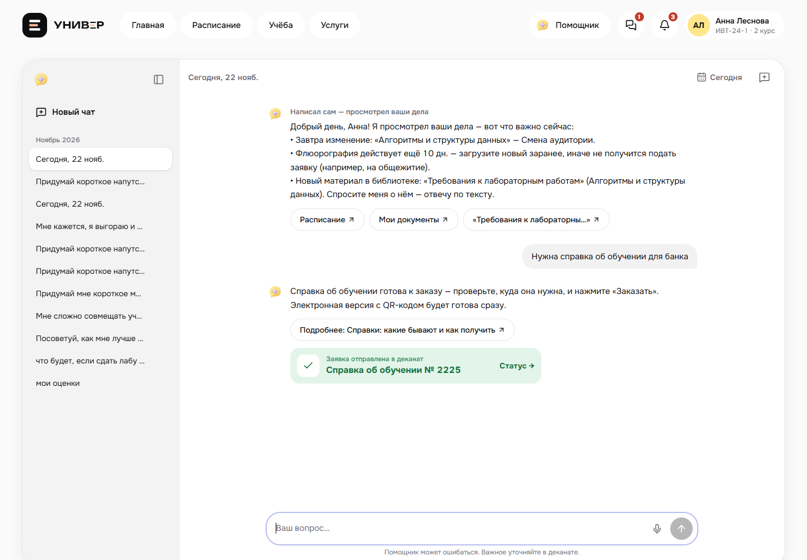
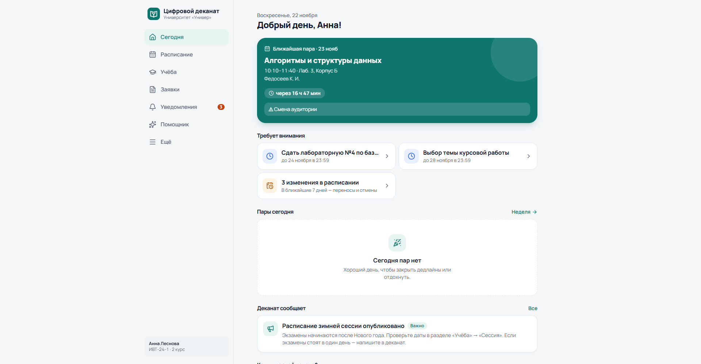
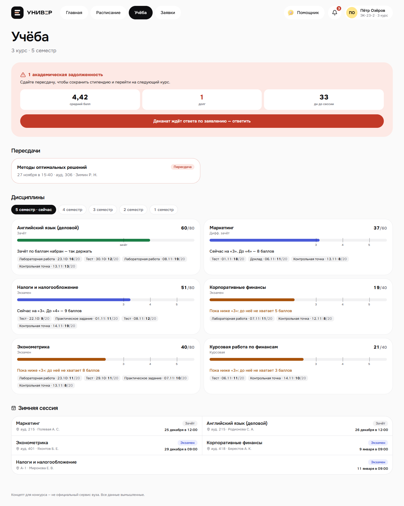
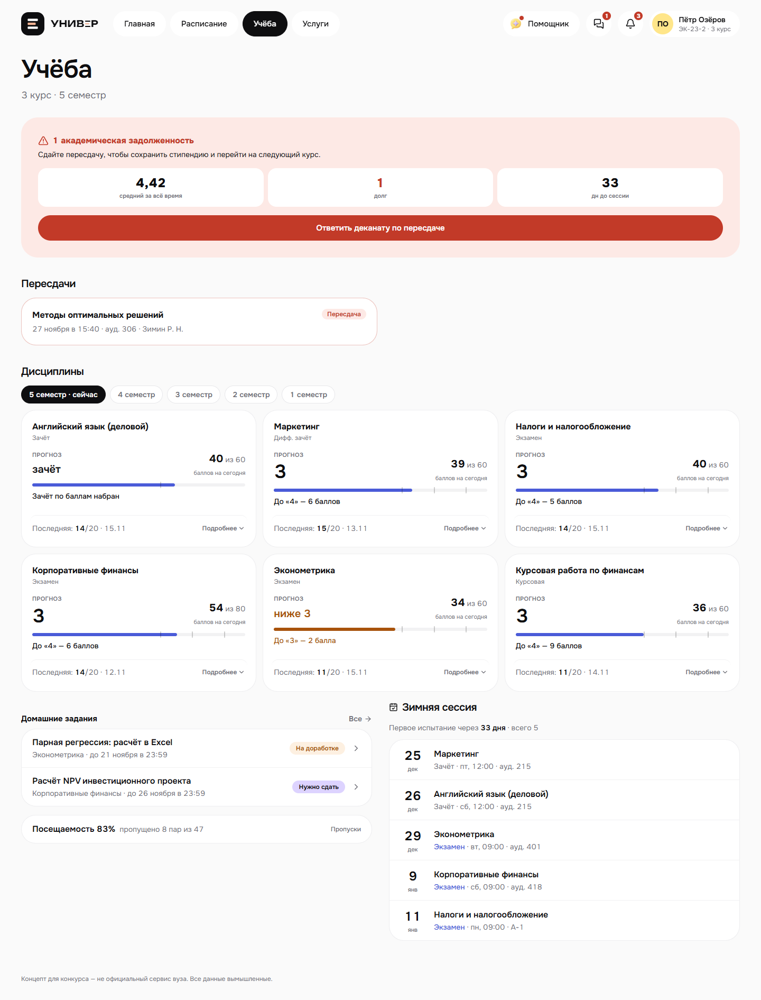

# «Цифровой деканат»: как мы создавали кабинет с нейросетями

> Копия документа Claude Docs для агентов без доступа к документу (ChatGPT/Codex, Kimi и другие). Скриншоты — рядом, в `screenshots/`. Правки предлагаются репликой в `R-20261122-otchet-dlya-zhyuri.md`; координатор переносит их в документ и обновляет этот файл.

## Коротко о проекте

«Цифровой деканат» — кабинет вуза для студента, преподавателя и деканата, построенный вокруг одной идеи: не показывать данные, а вести студента от сигнала к результату. Сервис работает по адресу [service.setoffice.ru](https://service.setoffice.ru), все данные в нём вымышленные. История разработки, журнал работы с ИИ и аудиты — в [репозитории](https://github.com/SetOffice24/digital-dekanat).

Как посмотреть за 5 минут:

1. Студентка anna.lesnova: «Мой день», прогноз оценок в «Учёбе», просьба помощнику «нужна справка для банка».
2. Деканат: та же заявка во «Входящих», перенос пары.
3. Преподаватель: отметка посещаемости фразой «нет Лесновой» — и снова кабинет студентки.

| Роль | Логин | Пароль |
| --- | --- | --- |
| Студентка, без долгов | anna.lesnova | Anna-Univer-2026 |
| Студент, есть долг | petr.ozerov | Petr-Univer-2026 |
| Сотрудник деканата | dekanat | Dekanat-Univer-2026 |
| Преподаватель | teacher | Teacher-Univer-2026 |

## Замысел: сопровождение вместо витрины

Исследование мы поручили двум агентам с веб-поиском: один разбирал отзывы о российских вузовских приложениях, другой — мировой опыт (Georgia State, Open University, Jisc). Из найденного мы сделали два вывода, которые определили весь продукт.

**Первый: не соревноваться там, где рынок уже занят.** Расписание, студбилет и зачётка, по найденным материалам, уходят в Госуслуги и MAX. Поэтому ценность вузовского кабинета мы искали в том, что там не сделают: в связи студента с деканатом и преподавателем, в заявках со статусом, в понятном следующем шаге.

**Второй: помогает не число функций, а своевременность.** Студенты жалуются, что узнают о переносе пары или о долге слишком поздно. А в мировой практике работают именно ранние сигналы и подсказки: по данным Georgia State, чат-бот с подсказками снизил летний отсев на 21,4%. Отсюда «Мой день», мгновенные извещения, прогноз итоговой оценки и помощник, который пишет первым.

Так же важно, от чего мы отказались:

| Идея | Почему не стали делать |
| --- | --- |
| Пропуск в Wallet, выписка оценок по QR (практики вузов Китая и США) | Эффектно, но не решает настоящих задач студента. Вместо этого мы искали пробелы в базовых сценариях |
| Ярлык «зона риска» для деканата | Ярлык ничего не меняет в работе. Сделали инструменты: ведомость, личное дело, прямую связь |
| Отдельные кабинеты для бухгалтерии, студгородка, ИТ | Каждая роль — новая граница доступа и поддержки. Услуги собрали в одно окно деканата |
| Свободный мессенджер «всем со всеми», внешние чаты | Спам, модерация, данные уходят из системы. Оставили диалоги по делу: студент — преподаватель — деканат |
| BI-дашборд | Тяжелее и хуже работает на телефоне, чем простая ведомость с выгрузкой |

Исследование кабинетное: по отзывам и публикациям, без собственного опроса. Источники: [отзывы о приложении ДВФУ](https://www.rustore.ru/catalog/app/ru.dvfu.univermobile/reviews), [ВШЭ о сервисах ЭИОС](https://skillbox.ru/media/education/elektronnye-informatsionnoobrazovatelnye-sredy-vuzov-obychno-ispolzuyutsya-ne-v-polnoy-mere/), [Georgia State, чат-бот Pounce](https://campustechnology.com/articles/2017/03/07/using-ai-chatbots-to-freeze-summer-melt-in-higher-ed.aspx).

## Процесс разработки: мультиагентная система

Мы не просто писали код с помощью чат-бота, а собрали команду из нескольких моделей разных поставщиков. У каждой своя роль, общие правила и общая память. Одна модель пишет код, другие независимо его проверяют, решения принимает человек.

Схема (в документе — рисунок):

```
                     Команда — решает
          (задачи, выбор вариантов, доступы, ключи)
       │ задачи              │                    ▲ замечания
       ▼                     ▼                    │
  Пишут код              Рисуют               Проверяют
  Claude Opus 5.5        OpenAI gpt-image     Astra 6/6.1 Sol — аудиты
  Claude Fable 5.1       фон входа, иконка    Kimi 3.1 Pro — ревью и аудиты
  Claude Sonnet 5.5           │               ChatGPT — дизайн и тексты
       │ код                  │ картинки           ▲ проверяют
       └──────► Сервис service.setoffice.ru ───────┘
                внутри — GigaChat-2: помощник и распознавание
```

**Маршрутизация по моделям.** Перед стартом мы разложили работу по стадиям и подобрали под каждую модель:

| Стадия | Модель | Почему |
| --- | --- | --- |
| Исследование | Два субагента Claude с веб-поиском, параллельно | Два независимых источника: отечественные отзывы и мировой опыт |
| Архитектура | Claude Fable 5.1 | Самая сильная модель для системных решений: модель данных, разграничение доступа, план |
| Оркестрация и основной код | Claude Opus 5.5 | Держит общую картину, распределяет задачи субагентам и принимает их работу |
| Параллельные блоки | Субагенты Claude Sonnet 5.5 | Кабинет сотрудника, справки с QR и кабинет преподавателя писались параллельно с основной работой, в закреплённых зонах файлов |
| Независимый аудит | Codex (ChatGPT Astra 6 и 6.1 Sol) | Другой поставщик, другие слепые зоны: безопасность, сценарии, адаптивность, проходы в браузере |
| Правила и ревью идей | Kimi Code CLI (Kimi 3.1 Pro) | В режиме «только чтение»: общие правила агентов, пространство идей, возражения по модели угроз |
| Нейросеть внутри продукта | GigaChat-2 | Работает из России; без неё сервис переходит на правила |

**Общая память агентов.** Контекст одной модели недоступен другой, поэтому всё важное живёт в репозитории:

- AGENTS.md — единые правила для любой модели: принципы продукта, границы доступа, порядок работы;
- HANDOFF.md — текущее состояние проекта и подводные камни окружения;
- журнал процесса — задача, модель, промпт, результат и ошибки ИИ на каждом шаге;
- карточки идей — асинхронное обсуждение между агентами: статусы, реплики «поддержка / возражение / альтернатива», итог координатора и отдельное поле «решение команды».

**Цикл проверки.** Аудит → разбор автором → решение команды → исправление с тестом → повторный аудит. Аудитор фиксирует проверяемый коммит и воспроизводит дефекты в изолированном окружении, не трогая общую базу. В каждом отчёте есть область, метод и пределы проверки: «оснований утверждать "уязвимостей нет" нет».

**Контур качества.** Перед каждой сдачей работы агент прогоняет проверку типов, линтер и автотесты. Тестов стало свыше 150, они закрепляют разграничение доступа и исправленные находки аудитов. Дальше сборка боевой версии и проход в браузере глазами пользователя, в том числе на ширине телефона 360 px. Работа не считается сделанной, пока есть ошибки проверок или не проверен критичный сценарий.

**Безопасность процесса.** Агенты не читают файлы с секретами. Отправка кода, действия на сервере и новые зависимости — только по команде человека. Операции, которые меняют общее состояние (миграции, тестовые данные, сборка), агенты выполняют строго по очереди, чтобы не сломать проверку другого агента.

## Как мы ставили задачи нейросетям

Качество результата определялось постановкой задачи. Ниже промпты, в которых это видно лучше всего: сначала наши, потом брифы, которые агенты писали друг другу по нашим правилам.

**Декомпозиция до кода.** Работа раскладывается по стадиям, и под каждую подбирается исполнитель:

> «Ознакомься с подробным описанием технического задания и продумай план того, как мы это будем реализовывать. В частности, посмотри, какие из этих стадий можно делегировать для модели Fable, условно, архитектуры».

**Порядок этапов и границы продукта.** Сначала исследование, потом состав, потом архитектура; объём сверяется с ТЗ до того, как его начнут строить:

> «…передовой мировой опыт. На что сейчас есть запрос со стороны студентов?… определимся итогово с тем, что у нас будет. И после этого… передам Fable».
>
> «…нужна ли админка к этому сервису по требованиям конкурса… Этот момент нужно уточнить на раннем этапе разработки».

**Делегирование без пересечений.** Задачи распределяются по сильным сторонам агентов; если зоны не развести, второй агент становится ревьюером:

> «Разбей задачи на несколько этапов выполнения. А также предложи то, с чем можешь справиться ты лучше, а что менее важное можно делегировать другим агентам… учти так, чтобы ваши работы не пересекались… Если нет, то… агент будет там ошибки искать».

**Управление контекстом и триаж замечаний.**

> «Агент тоже видит тот контекст, который был, поэтому ты пиши не так, как будто я ему отправляю с чистого листа».
>
> «Исправь наиболее явные изменения и составь список тех, которые нужно проверить ещё лично».

**Бриф архитектору.** В задании есть критерий готовности, модель под каждую задачу и обязательная фиксация допущений:

> «Документ ARCHITECTURE.md — достаточный, чтобы агенты-разработчики работали по нему без уточнений… План реализации — задачи по приоритету, для каждой: что сделать, критерий готовности, какой модели поручить… Открытые вопросы — зафиксируй допущения».

**Бриф исследователям.** Задан формат результата, обязательны источники, факты отделены от интерпретаций:

> «Нужен итог (на русском, до ~700 слов): топ-10 болей… с одной ссылкой-источником на каждую… Не логинься никуда, не заполняй форм… Указывай, где выводы — твоя интерпретация, а где прямо из источника».

**Бриф параллельному разработчику.** Зона файлов задана через запреты, критерии приёмки явные, в отчёт входят сомнения агента:

> «Твоя зона (параллельно другой агент делает экраны студента — НЕ трогай src/app/(student)/**)… Проверка (обязательно): tsc --noEmit без ошибок… Не делай git commit… В конце: что не получилось, какие решения принял сам… 1–2 места, где ты сомневаешься».
>
> «Главное требование — ПРОСТОТА: человек без инструкции за 10 секунд понимает, куда поставить оценку».

**Правила для всех агентов (AGENTS.md).**

> «До начала задачи зафиксировать в постановке: цель, разрешённую область файлов, запрещённые области, зависимости и критерии готовности».
>
> «Не называть работу завершённой при ошибках проверок или непроверенном критичном сценарии. Точно перечислить, что проверено, а что нет и почему».
>
> «Согласие агентов не считается одобрением. Реализация новых разделов, зависимостей и архитектурных изменений начинается только после явного решения команды».

## Ключевые идеи и развилки

Нейросеть предлагает быстро и много, поэтому главной работой команды было формулировать принципы и отсекать лишнее. Ниже — пять решений, которые сильнее всего повлияли на продукт.

### 1. Автоматизация — соразмерно цене ошибки

Это центральная идея проекта. Нейросеть предложила два полюса: помощник либо только отвечает, либо сам действует в кабинете. Мы искали третий вариант, в котором польза есть, а риск контролируем:

> «Можем сделать это ограниченно… только к некоторым функциям, какой-нибудь самой рутинной. Это позволит упростить контроль безопасности и при этом продемонстрирует технологичность».

Первым кандидатом нейросеть назвала оценки: преподаватель диктует баллы, модель их распознаёт. Мы отказались: ошибка распознавания в оценке бьёт по студенту и незаметна. Вместо этого выбрали задачу с дешёвой и видимой ошибкой:

> «Насчёт оценок я не очень согласен… тут очень важна точность. Может быть, можно попробовать отметку посещаемости автоматизировать, если она у нас есть. Если нет — надо добавить».

Из этого родился принцип «ИИ распознаёт — человек нажимает». Нейросеть понимает свободную фразу и готовит действие, а подтверждает его человек. При неоднозначности помощник переспрашивает, а не угадывает: например, когда в группе два студента с одной фамилией. Решения о других людях, то есть решения деканата, нейросеть не принимает вообще, только готовит черновики.

Потом мы развили идею в «умный чат»: по запросу пользователя в диалоге открывается нужный фрагмент кабинета. Главная сложность тут не в генерации текста, а в точном определении намерения. Пример: студентка пишет «Нужна справка об обучении для банка», получает карточку, нажимает «Заказать», и заявка № 2225 сразу попадает к деканату.




### 2. Роли определяются замкнутыми сценариями

Сколько ролей нужно, мы определяли по тому, замыкается ли сценарий студента. Нейросеть начала с двух ролей — студент и деканат, но тогда оценке, ДЗ и посещаемости неоткуда взяться. Позже она предложила обратное — отдельные кабинеты для каждой службы. Мы остановились на трёх ролях с таким рассуждением:

> «Давай не будем плодить слишком много сущностей… услуги, которые потенциально могут быть у деканата, — в деканат, а те, которые требуют исключительно профильных решений, удали».

Каждая лишняя роль — это новая граница доступа, которую нужно защищать, и новый интерфейс, который нужно поддерживать. Пользы для студента от неё нет.

### 3. Простота как правило, а не стиль

Первые версии были функционально полными, но перегруженными. Мы заметили закономерность: нейросеть склонна добавлять каждую новую функцию отдельным пунктом или блоком. Тогда мы сделали простоту ограничением архитектуры, а не пожеланием к дизайну:

- у студента ровно четыре раздела, новая функция встраивается в существующий;
- функции не удаляются, а раскрываются по мере надобности;
- цвет несёт смысл: если выделено всё, не видно главного, например долга.

Первая версия, воспроизведённая из истории репозитория, и итоговая:




Тот же принцип на разделе «Учёба». Демо-значения на снимках разные, сравнивается устройство экрана:





### 4. Функции вместо ярлыков

Нейросеть часто предлагала решения, которые хорошо выглядят на схеме, но не меняют работу людей: «зону риска» для деканата, переписку только внутри заявок. Мы возвращали её к вопросу «что человек сможет сделать»:

> «Давай мыслить именно функционалом системным… чтобы студенты, преподаватели и деканат могли писать друг другу».

Вместо ярлыка получились ведомость с выгрузкой, личное дело и личные диалоги между ролями. Также мы просили нейросеть искать упущенное в базовых сценариях, а не придумывать новое. Так нашли, что одобренная уважительная причина не меняла посещаемость.

### 5. Проверять, а не доверять

Ответы нейросети мы считали гипотезами, которые нужно подтвердить. Два примера.

**Сверка с первоисточником.** Для подключения GigaChat нейросеть предложила громоздкую схему. Мы дали ей официальную инструкцию с комментарием «мне кажется, ты переусложняешь», и решение стало втрое проще. Раньше архитектор сам решил за нас, какую нейросеть ставить внутрь продукта, и это тоже пришлось поправлять.

**Независимый аудит.** Код Claude проверял Codex (модели ChatGPT Astra 6 и 6.1 Sol): чтением кода, изолированным воспроизведением и проходами в браузере под разными ролями. Замечания мы не пересылали автору вслепую, а просили сначала оценить последствия. Часть правок откатили, потому что они ломали нужное поведение. Самая важная находка: преподаватель одной подгруппы мог изменить оценку студенту другой. Её исправили во всех местах и закрепили автотестом. Когда аудитор заметил, что сам тест может молча ничего не проверить, мы исправили и его.

Мы попросили аудитора оценить процесс со стороны:

> «Независимое замечание должно проверяться на последствия, а не автоматически исполняться… Такой процесс даёт проверяемые свидетельства работы команды с ИИ, но не заменяет проверку реального развёртывания перед использованием персональных данных». (Codex)

## Инструменты

| Инструмент | Роль |
| --- | --- |
| Claude Code: Claude Opus 5.5, Fable 5.1, Sonnet 5.5 | Архитектура (Fable), основной код и выкладка (Opus), параллельные задачи по чёткому заданию (Sonnet), исследование с веб-поиском, проверка в браузере |
| Codex (OpenAI), модели ChatGPT Astra 6 и 6.1 Sol | Независимые аудиты безопасности, сценариев, дизайна и адаптивности, в том числе в браузере (Computer Use); рецензия отчёта |
| Kimi Code CLI, модель Kimi 3.1 Pro | Общие правила агентов и пространство идей, аудиты и ревью без правок кода, возражения в карточках идей |
| OpenAI Image (gpt-image-2.5-flare) | Фон страницы входа и иконка помощника |
| GigaChat-2 (Сбер) | Нейросеть внутри сервиса: распознавание просьб и ответы помощника |
| GitHub, VPS Jino, Docker, nginx | История изменений и работающий сервис |

## Вход, данные и защита

Основной принцип: каждый видит только своё. Это проверяет сервер при каждом запросе, а не интерфейс. Правила закреплены автотестами и проверены независимыми аудитами.

- **Вход.** Логин и пароль. Пароли хранятся только в виде отпечатка (argon2id), число попыток ограничено. Ключ сессии недоступен скриптам страницы, в базе хранится только его отпечаток.
- **Разграничение.** Студент видит только свои данные. Преподаватель — только свои группы и подгруппы. Деканат — свой факультет, а файлов с решениями студентов не видит. Чужая ссылка отдаёт «не найдено».
- **Хранение.** База данных на сервере в России, из интернета недоступна. Файлы лежат под случайными именами и отдаются только после проверки прав. Ключи — только в настройках сервера, не в коде. Каждую ночь снимается резервная копия.
- **Нейросеть.** Получает только сведения, доступные пользователю по его роли. Текст пользователя отделён от инструкций, а право на любое действие сервер проверяет заново. Без нейросети сервис продолжает работать по правилам.

Перед работой с настоящими данными нужны отдельная учётная запись базы с минимальными правами, копии вне сервера, второй фактор входа для сотрудников и согласованная с вузом политика передачи данных нейросети.

## Что оставалось за людьми

- **Продуктовые решения.** Роли, состав разделов, принцип «ИИ распознаёт — человек нажимает», отказ от автоматизации оценок, выбор того, что делать дальше.
- **Координация агентов.** Постановка задач, передача аудитов от одной модели другой, решение, какие замечания принимать.
- **Проверка глазами пользователя.** Просмотр на своих устройствах и обратная связь по скриншотам.
- **Доступы.** Ключи сервисов, сервер и публикация: агент выполнял действия только по явной команде.

## Итог

Главное, что мы вынесли из работы с нейросетями:

- **Ценность команды — в отборе.** Нейросеть порождает варианты быстрее человека. Решающими оказались принципы, по которым мы их отбирали: цена ошибки, замкнутость сценария, функция вместо ярлыка.
- **Нейросети ошибаются уверенно.** Часть ошибок не видна ни сборке, ни тестам: их находит только независимая проверка или человек.
- **Проверка важнее генерации.** Устойчивый результат дала связка «одна модель пишет — другая проверяет — человек решает».

Чего мы не утверждаем: справка с QR — не юридически значимый документ; эффект на успеваемость не измерен; нагрузка целого вуза не проверялась.
